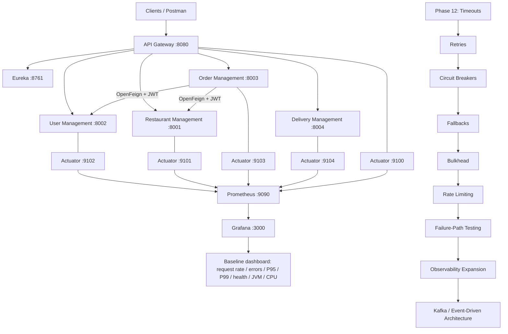

# FoodManagement — Roadmap Architecture

## Purpose

This document is the project-level architecture and delivery roadmap. It separates what is implemented today from the next engineering gates and the later container/cloud platform phases.

## Visual architecture



## 1. Current runtime architecture

```
Client / Postman
       |
       v
API Gateway :8080
       |
       +--------------------+
       |                    |
       v                    v
   Eureka :8761      JWT / RBAC at edge
       |
       +------------------------------+
       |              |               |
       v              v               v
User :8002     Restaurant :8001   Order :8003
                                      |
                                      | OpenFeign + JWT propagation
                                      +----------> User :8002
                                      |
                                      +----------> Restaurant :8001
       |
       v
Delivery :8004
```

Business APIs remain protected by the existing JWT and USER / ADMIN authorization model.

## 2. Observability architecture — implemented

```
Spring Boot services
  |  management ports
  |  9100 / 9101 / 9102 / 9103 / 9104
  v
Actuator + Micrometer
  |
  v
/actuator/prometheus
  |
  v
Prometheus :9090
  |
  v
Grafana :3000
  |
  +--> Request Rate
  +--> Error Rate
  +--> P95 / P99 Latency
  +--> Service Health
  +--> JVM Heap
  +--> CPU
```

Prometheus and Grafana currently run in Docker. The five Spring Boot application services continue to run as local JVM processes.

## 3. Roadmap execution gates

```
Phase 11
API Gateway + OpenFeign + Eureka + JWT/RBAC
        |
        v
Phase 18A
Observability Foundation
[COMPLETE]
        |
        v
Phase 12
Fault Tolerance
[next: Timeouts]
        |
        v
Failure-Path Testing
        |
        v
Phase 18C
Observability Expansion
[Logging / Correlation / Tracing / Alerts]
        |
        v
Phase 11B
Kafka / Event-Driven Architecture
[deferred until gates above pass]
```

## 4. Fault-tolerance implementation sequence

```
Timeouts
   |
   v
Retries
   |
   v
Circuit Breakers
   |
   v
Fallbacks
   |
   v
Bulkhead Isolation
   |
   v
Rate Limiting
   |
   v
Failure-Path Validation
```

The observability dashboard remains active throughout this work so resilience changes can be compared against the pre-resilience baseline.

## 5. Platform engineering roadmap

After the resilience/observability gates:

```
Data & Transaction Hardening
        |
        v
Testing & Quality Engineering
        |
        v
Full Application Dockerization
        |
        v
Kubernetes
        |
        v
CI/CD
        |
        v
AWS / Cloud Deployment
        |
        v
Production Hardening
```

The current observability Docker Compose stack is intentionally smaller:

```
Docker Compose
  +--> Prometheus
  +--> Grafana
```

It is not the full application containerization phase.

## 6. Docker image lifecycle for the later application phase

```
Source code
   |
   v
Dockerfile
   |
   v
docker build
   |
   v
Container image
   |
   +--> docker push --> Container Registry
   |
   +--> docker run / Compose / Kubernetes
```

An image is the packaged template. A container is a running instance. Pushing an image is a registry operation; it is not an operation that places an image inside another container.

## 7. Current status summary

| Area | Status |
|---|---|
| Eureka service discovery | Complete |
| OpenFeign synchronous calls | Complete |
| JWT / USER / ADMIN security | Complete |
| API Gateway | Complete |
| Observability Foundation | Complete |
| Prometheus | Validated |
| Grafana | Validated |
| Fault Tolerance | Next |
| Kafka | Deferred |
| Full Dockerization | Later phase |
| Kubernetes | Later phase |
| CI/CD | Later phase |
| AWS / Cloud | Later phase |

## 8. Definition of done before Kafka

Kafka is not the next implementation step.

Before Kafka starts, the project should have:

- Timeout behavior implemented and validated
- Retry behavior implemented and validated
- Circuit breakers implemented and validated
- Fallback behavior implemented and validated
- Bulkhead isolation implemented and validated
- Rate limiting implemented and validated
- Failure-path tests completed
- Resilience metrics visible in Grafana
- Logging/correlation/tracing/alerts completed for the current local architecture

This is the project-level architectural gate for moving into event-driven communication.
