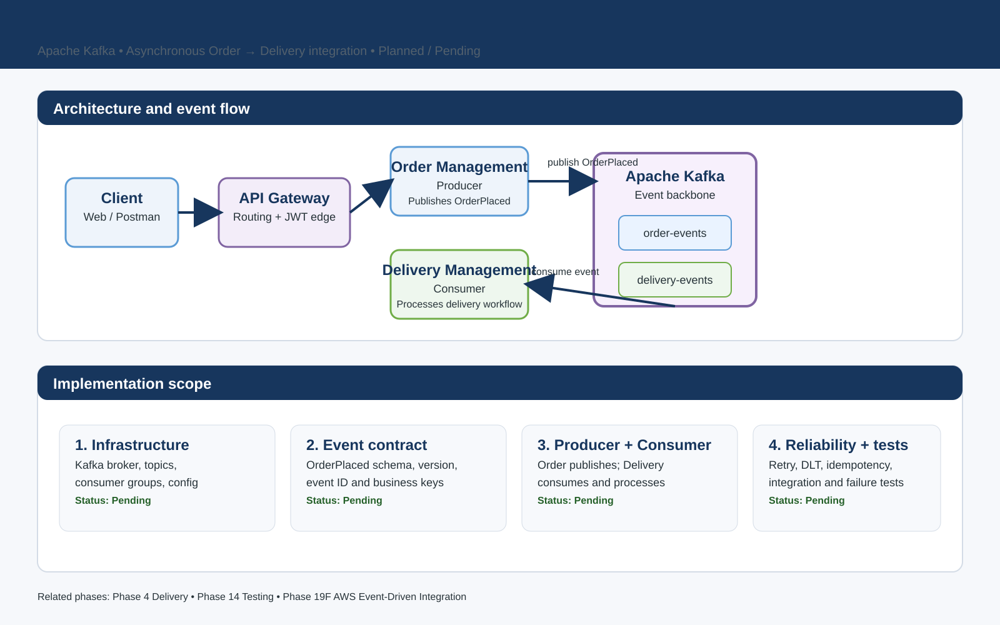

# Phase 11B — Event-Driven Architecture

> **Status:** Pending / planned  
> **Primary pattern:** Apache Kafka-based asynchronous communication  
> **Primary business flow:** Order Management -> Kafka -> Delivery Management

[Back to project wiki](README.md) · [Pending Task Matrix](README.md#pending-task-matrix) · [Phase 11B diagram](PHASE_11B_EVENT_DRIVEN_ARCHITECTURE.svg)

## 1. Purpose

Phase 11B introduces asynchronous, event-driven communication into FoodManagement.

The objective is to reduce direct runtime coupling between business services, allow consumers to process events independently, and establish a foundation for future event-driven capabilities such as notifications, analytics, and delivery workflow automation.

The first business flow is:

    Client
      -> API Gateway
      -> Order Management
      -> Kafka
      -> Delivery Management

The existing synchronous integrations remain in place:

- Order Management -> User Management
- Order Management -> Restaurant Management
- Client -> API Gateway -> business services

Kafka is introduced for asynchronous business events rather than replacing every existing synchronous call.

## 2. Architecture

### Runtime responsibilities

| Component | Responsibility |
|---|---|
| API Gateway | Receives external API traffic and routes requests to business services. |
| Order Management | Validates and persists the order, then publishes the relevant domain event. |
| Kafka | Event backbone that stores and distributes events through topics. |
| Delivery Management | Consumes order events and performs the delivery-side workflow. |
| User Management | Remains a synchronous dependency for current order/user validation. |
| Restaurant Management | Remains a synchronous dependency for restaurant/item validation and pricing. |

## 3. Event flow

### OrderPlaced flow

1. Client places an order through the API Gateway.
2. Order Management performs the existing user and restaurant validation.
3. Order Management persists the order successfully.
4. Order Management publishes an `OrderPlaced` event.
5. Kafka writes the event to the configured order-event topic.
6. Delivery Management consumes the event.
7. Delivery Management processes the event and creates or advances the delivery workflow.
8. Processing is protected by retry/error handling and idempotency rules.

### Important design rule

The event should represent a **business fact that has already happened**.

Example event payload:

    {
      "eventId": "uuid",
      "eventType": "OrderPlaced",
      "eventVersion": 1,
      "occurredAt": "2026-11-13T10:15:30Z",
      "orderId": 401,
      "userId": 101,
      "restaurantId": 201
    }

The exact schema should be finalized during implementation before producers and consumers are committed.

## 4. Topics and events

| Topic | Event | Producer | Consumer | Purpose |
|---|---|---|---|---|
| `order-events` | `OrderPlaced` | Order Management | Delivery Management | Notify Delivery Management that an order has been placed. |
| `order-events` | `OrderAccepted` | Order Management | Future consumers | Notify downstream consumers of order acceptance. |
| `order-events` | `OrderPreparing` | Order Management | Future consumers | Notify downstream consumers that preparation has started. |
| `order-events` | `OrderOutForDelivery` | Order/Delivery flow | Future consumers | Support delivery-status workflow. |
| `order-events` | `OrderDelivered` | Order/Delivery flow | Future consumers | Notify downstream systems that delivery is complete. |
| `order-events` | `OrderCancelled` | Order Management | Future consumers | Notify downstream systems of cancellation. |

The first implementation target is **OrderPlaced**. Additional events should be added only when they have a concrete consumer/use case.

## 5. Implementation plan

### Step 11B.1 — Kafka infrastructure
- Choose the local Kafka runtime approach.
- Configure broker connectivity for development.
- Define topic names.
- Define consumer groups.
- Externalize Kafka configuration.
- Document startup and shutdown.

### Step 11B.2 — Domain event model
Create a stable event contract containing:
- `eventId`
- `eventType`
- `eventVersion`
- `occurredAt`
- Business identifiers required by the consumer

Avoid sending the entire database entity as the event payload.

### Step 11B.3 — Order Management producer
1. Detect successful order creation.
2. Construct the domain event.
3. Publish the event to Kafka.
4. Record/log the event key and topic.
5. Handle publication failures according to the agreed retry/error strategy.

The current synchronous validation of User and Restaurant remains unchanged.

### Step 11B.4 — Delivery Management consumer
1. Subscribe to the configured topic.
2. Deserialize the event.
3. Validate the event contract.
4. Apply the delivery-side business action.
5. Commit/acknowledge only after successful processing.
6. Route failures through the configured retry/dead-letter strategy.

### Step 11B.5 — Topics and consumer groups
Define:
- Topic names
- Partitions
- Replication strategy appropriate to the local environment
- Consumer group names
- Message key strategy

For the initial flow, the order identifier is the natural candidate for the message key so events for the same order can remain ordered within a partition.

### Step 11B.6 — Retry and error handling
The implementation must distinguish between:
- Temporary processing failures
- Permanent validation/business failures
- Malformed events

Target flow:

    Kafka message
        |
        v
    Consumer
        |
        +--> Success -> commit
        |
        +--> Temporary failure -> retry/backoff
        |
        +--> Persistent failure -> Dead Letter Topic

Do not allow an endlessly failing message to block healthy messages indefinitely.

### Step 11B.7 — Idempotency
Consumers must be safe to retry.

Use a stable event identifier and/or business identifier to detect duplicate processing.

    eventId = abc-123
            |
            v
    First delivery  -> process -> record processed
    Second delivery -> detect duplicate -> no duplicate delivery record

The exact persistence mechanism should be chosen during implementation.

### Step 11B.8 — Integration testing
At minimum, validate:
- Producer publishes the expected event.
- Consumer receives the expected event.
- End-to-end OrderPlaced flow creates the expected delivery-side result.
- Retry behavior works.
- Dead-letter behavior works.
- Duplicate events do not create duplicate business records.
- Malformed/invalid events fail safely.
- Existing synchronous Order/User/Restaurant behavior remains unaffected.

## 6. Testing strategy

Phase 11B testing is **Kafka-specific integration validation**. It contributes to Phase 14 but does not complete Phase 14 by itself.

| Test area | Phase 11B expectation | Phase 14 relationship |
|---|---|---|
| Producer test | Required | Contributes to service/integration coverage. |
| Consumer test | Required | Contributes to service/integration coverage. |
| Kafka integration test | Required | Directly satisfies the Kafka-testing portion. |
| End-to-end event flow | Required | Contributes to integration/service-to-service coverage. |
| Retry/DLT test | Required | Contributes to resilience test coverage. |
| Idempotency test | Required | Contributes to integration/negative-path coverage. |
| Full unit/controller/repository suite | Not enough for Phase 11B alone | Remains Phase 14 work. |
| Testcontainers | Recommended / Phase 14 | Broader automated infrastructure testing remains Phase 14. |
| WireMock / contract testing | Not required to close Phase 11B | Remains Phase 14. |
| Mutation testing | Not required to close Phase 11B | Remains Phase 14. |

## 7. Failure-path expectations

| Failure | Expected behavior |
|---|---|
| Kafka broker unavailable | Failure is handled without silently losing the business outcome. |
| Consumer processing failure | Retry with controlled backoff. |
| Persistent consumer failure | Message routed to a dead-letter topic. |
| Duplicate event | No duplicate delivery business record. |
| Invalid event payload | Rejected safely and observable. |
| Consumer restart | Processing resumes according to committed offsets and idempotency rules. |
| Existing User/Restaurant failure | Existing synchronous 503/504/resilience behavior remains unchanged. |

## 8. Observability requirements

The existing Actuator/Micrometer/Prometheus/Grafana foundation remains the local observability baseline.

Kafka implementation should expose enough information to troubleshoot:
- Topic
- Partition
- Offset where relevant
- Event type
- Event ID
- Order ID
- Consumer group
- Retry count where available
- Processing success/failure
- Dead-letter routing

Correlation IDs can be added as part of the later observability expansion if not introduced during this phase.

## 9. Security considerations

Do not put the following into event payloads unless explicitly required by the consumer:
- Passwords
- JWT secrets
- Database credentials
- Unnecessary sensitive personal data

Publish only the fields required for the business action.

## 10. Scope boundary

This phase does **not** replace:
- Existing User Management synchronous validation
- Existing Restaurant Management synchronous validation
- API Gateway routing
- Phase 12 resilience controls
- Phase 14 comprehensive automated testing
- AWS messaging implementation

The later AWS phase will compare the local Kafka architecture with AWS messaging services and map the design to managed services where appropriate.

## 11. Definition of Done

Phase 11B is complete only when all of the following are validated:

- [ ] Kafka infrastructure starts successfully.
- [ ] Topic and consumer-group configuration is versioned.
- [ ] Domain event schema is documented.
- [ ] Order Management producer is implemented.
- [ ] Delivery Management consumer is implemented.
- [ ] OrderPlaced event flow works end to end.
- [ ] Retry and backoff behavior is validated.
- [ ] Dead-letter handling is validated.
- [ ] Consumer idempotency is validated.
- [ ] Duplicate events do not create duplicate delivery records.
- [ ] Existing synchronous Order -> User and Order -> Restaurant flows remain regression-safe.
- [ ] Kafka integration tests pass.
- [ ] Failure-path testing passes.
- [ ] Documentation and architecture diagrams are synchronized.

## 12. Expected phase impact

| Phase | Expected impact |
|---|---|
| Phase 4 — Delivery Management | Event-driven integration becomes complete; broader quality hardening remains. |
| Phase 11 — Synchronous + Edge + Event-Driven | Phase 11 can be marked complete once 11B is validated because 11A is already complete. |
| Phase 14 — Testing and Quality Engineering | Kafka tests and initial event-driven integration coverage are completed, but the full testing phase remains pending. |
| Phase 18 — Observability | Kafka-specific metrics/logging can improve visibility, but 18B/18C are not automatically completed. |
| Phase 19F — AWS Event-Driven Integration | The Kafka design becomes the reference architecture for later SQS/SNS/EventBridge/MSK comparisons. |

## 13. Related documentation

- [FoodManagement project wiki](README.md)
- [Pending Task Matrix](README.md#pending-task-matrix)
- [Project architecture roadmap](FOODMANAGEMENT_ROADMAP_ARCHITECTURE.md)
- [Order Management README](ordermanagement/README.md)
- [Delivery Management README](deliverymanagement/README.md)